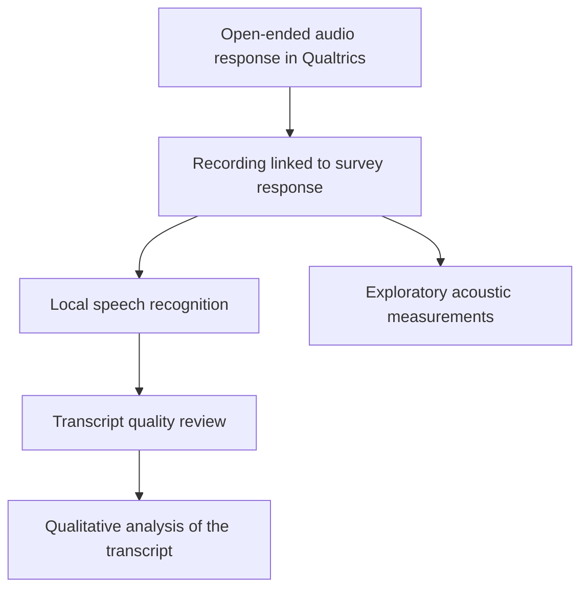

# Survey Audio in Field Research

This project documents a workflow for collecting spoken responses to open-ended survey questions, transcribing them locally, and reviewing transcript quality. The research team integrated audio recording into Qualtrics and links each recording to its survey response. Transcription runs locally to avoid sending study recordings to an external transcription service.



The acoustic analysis is in development. We are exploring whether measures such as timing, pitch variation, and intensity can add context to what respondents say. In the demo, low-energy frames are a descriptive signal measure. They can reflect silence, quiet speech, or recording conditions. Interpreting vocal expression requires the recording and question context.

## Run the synthetic example

This example uses an English text-to-speech recording, its known source text, and a deliberately edited transcript. It demonstrates review logic independently of speech recognition.

```bash
python audit_audio.py example.wav example_transcript.txt --reference reference.txt
```

The script reports duration, RMS level in dBFS, and the fraction of samples in 20 ms frames with an RMS level at or below −40 dBFS. The synthetic example is flagged because one word was removed from the transcript. The known reference is specific to the demo.

## Optional local transcription

With a local whisper.cpp installation and a compatible model already downloaded, you can generate a new transcript from the synthetic WAV:

```bash
whisper-cli -m /path/to/ggml-model.bin -f example.wav -otxt -of local_transcript
python audit_audio.py example.wav local_transcript.txt --reference reference.txt
```

The repository contains only synthetic audio and text. The study recordings, transcripts, and survey-response identifiers are held in the study environment.
