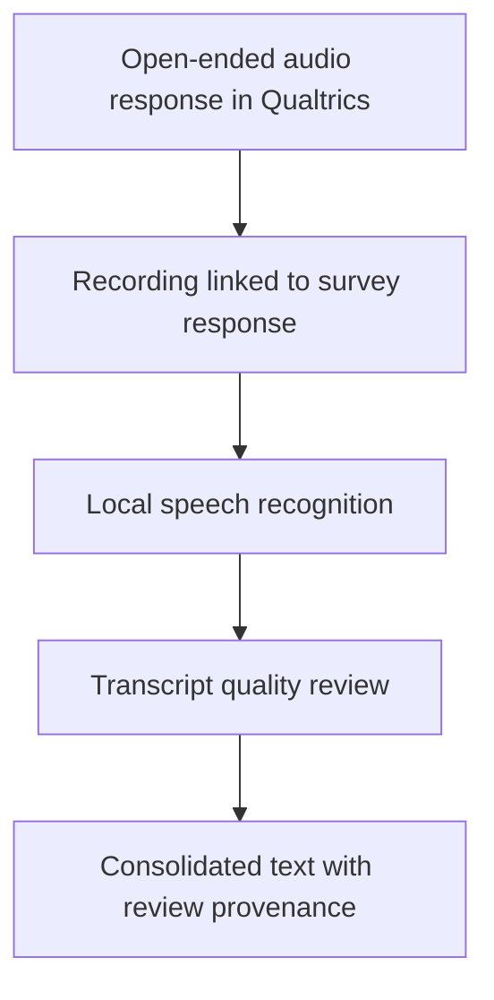

# Survey Audio in Field Research

This project documents a workflow for collecting spoken responses to open-ended survey questions, transcribing them locally, and reviewing transcript quality. The research team integrated audio recording into Qualtrics and links each recording to its survey response. Transcription runs locally to avoid sending study recordings to an external transcription service.



Qualitative coding, text-based sentiment analysis, and acoustic analysis are subsequent research steps. The acoustic analysis is in development. We are exploring whether measures such as timing, pitch variation, and intensity can add context to what respondents say. In the demo, low-energy frames are a descriptive signal measure. They can reflect silence, quiet speech, or recording conditions. Interpreting vocal expression requires the recording and question context.

## Completed production workflow

*November 2026 — Local transcription and automated quality assessment completed for 507 recordings. Initial human review completed for 70 recordings.*

The workflow was developed in the context of Access to Gig Work and Exposure to Inequality, associated with J-PAL LAC / Insper. Optional audio responses were collected through Qualtrics and the Pipe recorder.

Before transcription, we inventoried recordings, identified duplicate-content files, and matched recording references to survey metadata. Four associations with unresolved response-ID conflicts were blocked from automatic processing. Selected MP4 files were converted to WAV with FFmpeg, then transcribed with a locally executed Whisper-based workflow. Restricted processing files were stored in Cryptomator encrypted volumes.

Quality screening used duration, RMS and peak levels, clipping, near-silence, and text indicators such as unusual repetition to prioritize human review. Low, Medium, and High indicate review priority. Calibrating these categories against intelligibility and transcription accuracy remains future work.

| Production stage | Recordings |
| --- | ---: |
| Converted to WAV | 507 |
| Transcribed locally | 507 |
| Audited | 507 |
| Selected for human review | 70 |

The review set combined 38 automatically flagged recordings and 32 sampled recordings.

| Human-review outcome | Recordings |
| --- | ---: |
| Approved | 37 |
| Corrected | 17 |
| Unintelligible | 16 |
| Total | 70 |

Reviewers listened to recordings and accepted the original ASR text, supplied a correction, or marked speech as unintelligible. The analytical dataset retains the original text, corrections, review outcome, and final text provenance. Unintelligible responses have missing analytical text.

Review annotations were synchronized into the analytical workbook using recording keys, with duplicate and missing-key checks and a timestamped backup. The earlier TXT and SQLite outputs retain the original ASR text. Rebuilding analytical files from those outputs requires carrying human-review annotations forward.

The review covered 13.8% of transcribed recordings and used a targeted selection. Collection-wide accuracy estimates would require a suitable evaluation sample and reliable reference transcripts. Optional audio participation also affects what can be inferred from the collection.

The public script below illustrates a small part of this workflow. Production scripts additionally handle linkage, manifests, duplicate detection, ASR orchestration, broader quality screening, and workbook synchronization.

## Run the synthetic example

This example uses an English text-to-speech recording, its known source text, and a deliberately edited transcript. It demonstrates review logic independently of speech recognition.

```bash
python audit_audio.py example.wav example_transcript.txt --reference reference.txt
```

The script reports duration, RMS level in dBFS, and the fraction of samples in 20 ms frames with an RMS level at or below −40 dBFS. The synthetic example is flagged because one word was removed from the transcript. The known reference is specific to the demo.

## Optional local transcription

With a local whisper.cpp installation and a compatible model already downloaded, you can generate a new transcript from the synthetic WAV:

```bash
whisper-cli -m /path/to/ggml-model.bin -f example.wav -otxt -of local_transcript
python audit_audio.py example.wav local_transcript.txt --reference reference.txt
```

The repository contains only synthetic audio and text. The study recordings, transcripts, and survey-response identifiers are held in the study environment.
